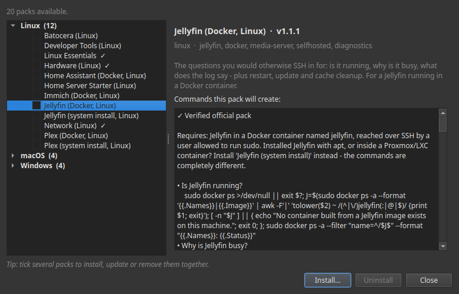

# Pacchetti di pulsanti

Un **pacchetto di pulsanti** è un insieme già pronto di pulsanti per un compito ricorrente: tenere in forma un server, liberare spazio sul disco, riavviare un servizio. Ne installi uno e quei compiti diventano pulsanti da premere, sul computer o sul telefono. Niente terminale e nessun comando da ricordare.

**Tutti i pacchetti sono gratuiti.** Li sfogli dentro Commandeck, ne installi uno con un tocco e lo togli con la stessa facilità.

## Che cos'è un pacchetto

Una cassetta degli attrezzi scelta a mano per un tipo di installazione, messa insieme da chi la usa davvero. La installi in pochi secondi e le tue faccende più frequenti diventano ciascuna un pulsante ordinato e pronto.

- **Scelto da chi lo usa**: le azioni che contano, senza rumore.
- **Gratis per tutti**: installane quanti vuoi, sul computer (Linux, macOS, Windows) *e* su Android, la cui app (in [test chiuso](android-beta.md)) ha la stessa galleria.
- **Verificato**: i pacchetti ufficiali sono firmati digitalmente; Commandeck controlla la firma e mostra un segno ✓ prima dell'installazione, così sai che è autentico e non manomesso.
- **Sicuro per costruzione**: ogni pulsante è visibile e modificabile, e tutto ciò che cambia o ferma qualcosa chiede conferma prima di partire.

---

## Ottenere un pacchetto: la galleria

Non c'è nessun file da cercare né alcun account da creare. Succede tutto dentro l'applicazione:

1. Apri Commandeck → menu **☰ → Pacchetti di pulsanti**.
2. Sfoglia la galleria. Scegli un pacchetto per leggere a che cosa serve e vedere i **comandi esatti** che ogni pulsante eseguirà.
3. Premi **Installa**. I pulsanti compaiono nella tua griglia, già ordinati.
4. Ci hai ripensato? Riapri il pacchetto e premi **Disinstalla**: toglie solo i pulsanti di quel pacchetto e lascia intatto il resto della griglia.
5. Quando esiste una versione più recente di un pacchetto che hai, la galleria lo segnala con un contrassegno **⬆ aggiorna**; premi **Aggiorna** per rinfrescarlo sul posto.

**Più pacchetti insieme.** Spunta la casella di quelli che ti interessano e usa la barra delle azioni per **installarli, aggiornarli o rimuoverli insieme**. Una selezione mista non è un problema: Commandeck installa i nuovi e aggiorna quelli che hai già in un solo passaggio, poi ti dice che cosa è cambiato.

La galleria scarica i pacchetti da internet e verifica ciascuno prima di installarlo.

## Dove girano i pacchetti

Installare un pacchetto è sempre gratis, e i pulsanti girano **in locale** — sul computer dove è installato Commandeck — senza alcun costo.

Il valore vero è farli girare sul tuo **server di casa**. Per mandare i comandi di un pacchetto a un'altra macchina via SSH ti servirà **Pro**, e ogni installazione include una **prova gratuita di 14 giorni, senza carta**. Pro è un acquisto unico da 29 $ — si compra una volta ed è tuo per sempre — ed è ciò che tiene in vita Commandeck; i pacchetti restano gratuiti, per sempre.

---

## Pacchetti disponibili

Ogni pacchetto è scritto per **un solo** sistema, e la galleria li ordina in sezioni Linux,
macOS e Windows. Oggi sono venti:

### Per il tuo server di casa (Linux, via SSH)

| Pacchetto | Cosa ti risponde | Guida passo passo |
|-----------|------------------|-------------------|
| **Jellyfin (Docker)** / **Jellyfin (system install)** | È attivo? Perché è lento? Cosa dice il log? In più riavvio, aggiornamento e pulizia della cache. | [Jellyfin](use-cases/jellyfin.md) · [Riavviare senza terminale](how-to/restart-jellyfin-plex-without-terminal.md) |
| **Plex (Docker)** / **Plex (system install)** | È attivo? Perché è lento? In più riavvio, aggiornamento, ricerca dei film nuovi e controllo del database. | [I film nuovi non compaiono](how-to/plex-not-showing-new-movies.md) · [Plex usa tutta la CPU](how-to/plex-using-all-cpu.md) |
| **Immich (Docker)** | Ogni parte è attiva? Dov'è finito lo spazio su disco? I backup del database avvengono davvero? In più un aggiornamento sicuro. | [Volti e ricerca non funzionano](how-to/immich-faces-search-not-working.md) |
| **Home Assistant (Docker)** | La mia configurazione è valida? Cosa non è partito? La chiavetta Zigbee è vista? In più un riavvio che controlla prima la configurazione. | [Controllare la configurazione prima del riavvio](how-to/home-assistant-check-config-before-restart.md) |
| **Home Server Starter** | I tuoi container Docker e quanto consumano, riavviarne uno, seguire i log, aggiornare tutto, liberare il disco di Docker. | [Comandi Docker come pulsanti](how-to/docker-commands-one-click-buttons.md) · [Server di casa](use-cases/home-server.md) |
| **Batocera** | La console retro sotto la TV: quale gioco è aperto, perché uno non parte, quali controller sono visti. In più chiudere un gioco bloccato e spegnere bene. | [Batocera](use-cases/batocera.md) |

Jellyfin e Plex esistono in due versioni: **Docker** se li hai installati con Docker, uno stack
Portainer o l'app store di un NAS; **system install** se li hai installati come pacchetto sulla
macchina stessa. Non lo sai? Installa la versione Docker e premi **Jellyfin è in esecuzione?**
(o **Plex è in funzione?**): te lo dirà.

### Per ogni computer (Linux, macOS, Windows: un pacchetto per sistema)

- **Essenziali Linux / macOS / Windows**: informazioni di sistema, log e manutenzione ordinaria.
- **Hardware**: dischi, memoria, processore, scheda grafica.
- **Rete**: interfacce, porte aperte e prove di connessione.
- **Developer Tools**: Git, Python e Node a colpo d'occhio, per chi programma sulla macchina.

*Ne arrivano altri*: dicci cosa usi.

---

## Pacchetti che crescono con te e con la tua comunità

Un pacchetto non è un file congelato. È una cassetta degli attrezzi viva:

- **Aggiornamenti gratuiti.** Quando un pacchetto guadagna azioni nuove o più precise, reinstallalo per aggiornarlo sul posto: la macchina che gli hai assegnato e le tue modifiche personali restano come le hai lasciate, e Commandeck **chiede** prima di toccare qualcosa che hai personalizzato.
- **Plasmati dalla comunità.** Questi pacchetti nascono dagli stessi forum e Discord che frequenti già. Ti manca un'azione? Proponila: le idee migliori arrivano a tutti con l'aggiornamento successivo.

---

## Domande frequenti

**Devo essere pratico di queste cose?**
No. Un pacchetto è una schermata di pulsanti: ne premi uno e leggi il risultato. Tutto ciò che potrebbe cambiare qualcosa chiede prima conferma, e puoi sempre vedere esattamente che cosa fa un pulsante.

**Come si installa un pacchetto?**
Apri **☰ → Pacchetti di pulsanti**, scegline uno e premi **Installa**. Per toglierlo, riapri lo stesso pacchetto e premi **Disinstalla**. Ne vuoi più d'uno? Spunta le caselle e installali, aggiornali o rimuovili tutti insieme dalla barra delle azioni.

**I pacchetti costano qualcosa?**
No, sono tutti gratuiti. Installare un pacchetto ed eseguire i suoi pulsanti in locale è gratis. Eseguirli su un'altra macchina via SSH usa Pro (che comprende 14 giorni di prova gratuita).

**Funzionerà sul telefono *e* sul computer?**
Sì. Sul computer (Linux, macOS e Windows) e su Android: l'app del telefono ha la stessa galleria ed è in [test chiuso](android-beta.md) prima di arrivare su Google Play. Sul telefono, i pulsanti di un pacchetto vengono eseguiti sulle tue macchine via SSH, mai sul telefono stesso.

**Gli aggiornamenti sono davvero gratuiti?**
Sì. Reinstalla il pacchetto e Commandeck lo aggiorna sul posto: mantiene la macchina che gli hai assegnato, rinfresca i pulsanti che non hai toccato e **chiede** prima di cambiare qualcosa che hai personalizzato.

**Posso modificare i pulsanti?**
Certo: rinominali, cambia loro colore, adattali. All'aggiornamento successivo le tue modifiche vengono rispettate; Commandeck non sovrascrive mai il tuo lavoro senza chiedere.

**La mia configurazione è un po' diversa, andrà bene lo stesso?**
La maggior parte delle azioni funziona così com'è. Qualcuna può aspettarsi uno strumento o una cartella tipici di quel genere di installazione (la pagina di ogni pacchetto dice che cosa dà per scontato). E se manca qualcosa che ti serve, dillo: è esattamente così che i pacchetti crescono.

**Serve un account?**
Nessun account, nessuna registrazione, nessun dato personale.

**È sicuro eseguirli?**
I pacchetti ufficiali sono firmati e vengono verificati prima dell'installazione. Il controllo resta tuo: ogni pulsante è visibile e modificabile, e tutto ciò che cambia o ferma qualcosa chiede conferma prima di partire.

**Posso proporre un pacchetto intero?**
Fallo pure. I prossimi pacchetti nascono direttamente da ciò che la gente chiede: la tua comunità potrebbe essere quella per cui costruiremo il prossimo.
