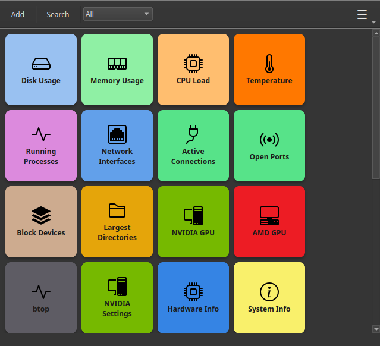

# Inicio rápido

Commandeck en marcha y tus primeros botones funcionando en unos cinco minutos.

## 1. Abre Commandeck

Después de [instalar Commandeck](installation.md), ábrelo desde el menú de aplicaciones (o
ejecuta la AppImage que descargaste).

La primera vez, la cuadrícula se llena de **botones listos para usar** para tu sistema,
ordenados en categorías como Hardware y Red. Pulsa cualquiera: el comando se ejecuta al momento.

## 2. Pulsa un botón

Pulsa **Uso del disco** para ver tus discos de un vistazo. Los botones que muestran algo lo abren
en una ventana pequeña; los demás lo confirman con un aviso breve.

## 3. Instala un pack de botones para lo que usas

No hace falta inventarse los botones. Abre **Menú ☰ → Paquetes de botones**: la galería tiene
packs gratuitos y listos para Jellyfin, Plex, Immich, Home Assistant, un servidor doméstico con
Docker, Batocera y más. Elige uno, lee el **comando exacto** de cada botón y pulsa
**Instalar…**.

Para ejecutar un pack en tu **servidor** y no en este ordenador, añade antes el servidor en
**Menú ☰ → Administrar máquinas**; esa parte es de [Commandeck Pro](pro.md), gratis durante
14 días. [Todos los packs →](packs.md)

## 4. Crea tu propio botón

1. Pulsa **Ctrl+N** (o **Añadir** en la barra de herramientas)
2. Rellena **Etiqueta**: el texto que se ve en el botón
3. Rellena **Comando**: el que, si no, tendrías que volver a buscar, por ejemplo `ping -c 4 8.8.8.8`
4. Pulsa **Guardar**

El botón aparece en la cuadrícula. Púlsalo para ejecutar el comando.

!!! tip
    La edición gratuita incluye **botones ilimitados en este ordenador**.
    [Commandeck Pro](pro.md) añade tus servidores por SSH, los temas y las copias de seguridad.

## 5. Ordena con categorías

En el editor del botón, escribe un nombre en el campo **Categoría** (por ejemplo `Red`). En la
barra de herramientas aparece una lista de categorías; elige una para ver solo sus botones.

## 6. Siguientes pasos

| Lo que quieres hacer | Dónde mirar |
|----------------------|-------------|
| Ver todos los packs listos | [Packs de botones](packs.md) |
| Conectar un servidor remoto | [Máquinas SSH](reference/ssh-machines.md) |
| Entender cada campo de un botón | [Editor de botones](reference/button-editor.md) |
| Conocer cada parte de la ventana | [Ventana principal](reference/main-window.md) |
| Ajustar columnas, tamaño, tema | [Preferencias](reference/preferences.md) |
| Ver ejemplos reales | [Casos de uso](use-cases/index.md) |
