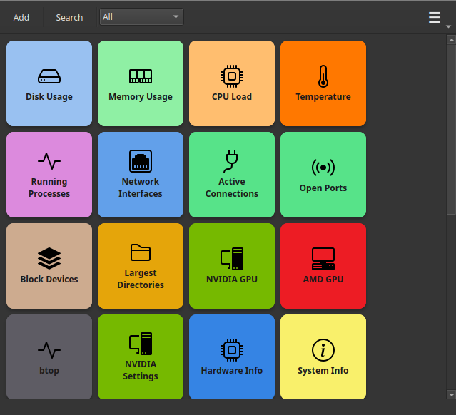

# Démarrage rapide

Commandeck lancé et vos premiers boutons en marche en cinq minutes environ.

## 1. Lancer Commandeck

Après avoir [installé Commandeck](installation.md), lancez-le — ouvrez **Commandeck** depuis le
menu des applications (ou lancez l'AppImage téléchargée).

Au premier lancement, la grille se remplit de **boutons prêts à l'emploi** pour votre système,
rangés en catégories comme Matériel et Réseau. Cliquez sur n'importe lequel : la commande
s'exécute aussitôt.

## 2. Lancer un bouton

Cliquez sur **Utilisation du disque** pour voir vos disques d'un coup d'œil. Les boutons qui affichent
quelque chose l'ouvrent dans une petite fenêtre ; les autres confirment par une courte
notification.

## 3. Installer un pack de boutons pour ce que vous faites tourner

Inutile d'inventer vos boutons. Ouvrez **Menu ☰ → Packs de boutons** : la galerie propose des
packs gratuits et tout prêts pour Jellyfin, Plex, Immich, Home Assistant, un serveur maison
Docker, Batocera, et d'autres. Choisissez-en un, lisez la **commande exacte** derrière chaque
bouton, puis appuyez sur **Installer…**.

Pour lancer un pack sur votre **serveur** plutôt que sur cet ordinateur, ajoutez d'abord le
serveur dans **Menu ☰ → Gérer les machines** — cette partie relève de
[Commandeck Pro](pro.md), gratuit pendant 14 jours. [Tous les packs →](packs.md)

## 4. Créer votre propre bouton

1. Appuyez sur **Ctrl+N** (ou cliquez sur **Ajouter** dans la barre d'outils)
2. Remplissez **Étiquette** — le texte affiché sur le bouton
3. Remplissez **Commande** — celle que vous iriez sinon rechercher, par exemple `ping -c 4 8.8.8.8`
4. Cliquez sur **Enregistrer**

Votre bouton apparaît dans la grille. Cliquez dessus pour lancer la commande.

!!! tip
    L'édition gratuite comprend des **boutons illimités sur cet ordinateur**.
    [Commandeck Pro](pro.md) ajoute vos serveurs en SSH, les thèmes et la sauvegarde.

## 5. Organiser avec des catégories

Dans l'éditeur de bouton, tapez un nom dans le champ **Catégorie** (par ex. `Réseau`). Une liste
de catégories apparaît dans la barre d'outils ; choisissez-en une pour n'afficher que ses
boutons.

## 6. Prochaines étapes

| Ce que vous voulez faire | Où regarder |
|--------------------------|-------------|
| Voir tous les packs tout prêts | [Packs de boutons](packs.md) |
| Connecter un serveur distant | [Machines SSH](reference/ssh-machines.md) |
| Comprendre chaque champ d'un bouton | [Éditeur de bouton](reference/button-editor.md) |
| Découvrir chaque élément de l'interface | [Fenêtre principale](reference/main-window.md) |
| Régler colonnes, taille, thème | [Préférences](reference/preferences.md) |
| Voir des exemples concrets | [Cas d'utilisation](use-cases/index.md) |
