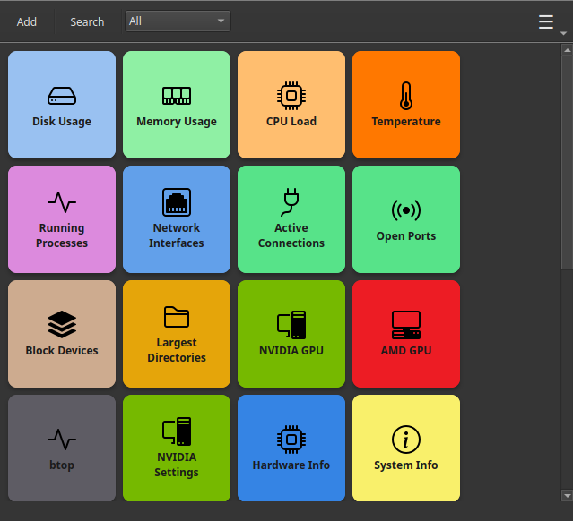

# Avvio rapido

Commandeck avviato e i primi pulsanti funzionanti in circa cinque minuti.

## 1. Apri Commandeck

Dopo aver [installato Commandeck](installation.md), aprilo dal menu delle applicazioni (o avvia
l'AppImage che hai scaricato).

Al primo avvio la griglia si riempie di **pulsanti pronti all'uso** per il tuo sistema, divisi
in categorie come Hardware e Rete. Premine uno qualsiasi: il comando parte subito.

## 2. Premi un pulsante

Premi **Utilizzo disco** per vedere i tuoi dischi a colpo d'occhio. I pulsanti che stampano
qualcosa lo mostrano in una piccola finestra; gli altri confermano con una breve notifica.

## 3. Installa un pacchetto di pulsanti per quello che usi

Non serve inventarsi i pulsanti. Apri **Menu ☰ → Pacchetti di pulsanti**: la galleria offre
pacchetti gratuiti e pronti per Jellyfin, Plex, Immich, Home Assistant, un server di casa con
Docker, Batocera e altro. Scegline uno, leggi il **comando esatto** di ogni pulsante e premi
**Installa…**.

Per eseguire un pacchetto sul tuo **server** e non su questo computer, aggiungi prima il server
in **Menu ☰ → Gestisci macchine**: questa parte è di [Commandeck Pro](pro.md), gratis per 14
giorni. [Tutti i pacchetti →](packs.md)

## 4. Crea un tuo pulsante

1. Premi **Ctrl+N** (oppure **Aggiungi** nella barra degli strumenti)
2. Compila **Etichetta**: il testo mostrato sul pulsante
3. Compila **Comando**: quello che altrimenti dovresti ricercare, per esempio `ping -c 4 8.8.8.8`
4. Premi **Salva**

Il pulsante compare nella griglia. Premilo per eseguire il comando.

!!! tip
    L'edizione gratuita include **pulsanti illimitati su questo computer**.
    [Commandeck Pro](pro.md) aggiunge i tuoi server via SSH, i temi e il backup.

## 5. Fai ordine con le categorie

Nell'editor del pulsante scrivi un nome nel campo **Categoria** (per esempio `Rete`). Nella
barra degli strumenti compare un elenco di categorie; scegline una per vedere solo i suoi
pulsanti.

## 6. Prossimi passi

| Cosa vuoi fare | Dove guardare |
|----------------|---------------|
| Vedere tutti i pacchetti pronti | [Pacchetti di pulsanti](packs.md) |
| Collegare un server remoto | [Macchine SSH](reference/ssh-machines.md) |
| Capire ogni campo di un pulsante | [Editor dei pulsanti](reference/button-editor.md) |
| Conoscere ogni parte della finestra | [Finestra principale](reference/main-window.md) |
| Regolare colonne, dimensioni, tema | [Preferenze](reference/preferences.md) |
| Vedere esempi reali | [Casi d'uso](use-cases/index.md) |
