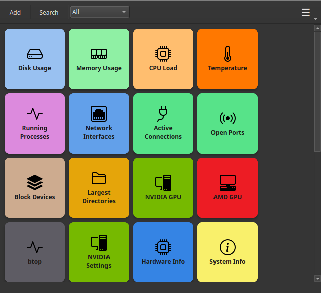

# Quick Start

Get Commandeck running and your first buttons working in about five minutes.

## 1. Launch Commandeck

After [installing Commandeck](installation.md), launch it — open **Commandeck** from your
applications menu (or run the AppImage you downloaded).

The first launch fills your grid with **ready-to-use buttons** for your operating system,
organised into categories such as Hardware and Network. Click any of them: the command runs at
once.

## 2. Run a button

Click **Disk Usage** to see your disks at a glance. Buttons that print something show it in a
small window; the others confirm with a short notification.

## 3. Install a button pack for what you run

You don't have to invent your buttons. Open **Menu ☰ → Button Packs**: the gallery lists free,
ready-made packs for Jellyfin, Plex, Immich, Home Assistant, a Docker home server, Batocera and
more. Pick one, read the **exact command** behind each button, then press **Install…**.

To run a pack on your **server** rather than this computer, add the server first in
**Menu ☰ → Manage Machines** — that part is [Commandeck Pro](pro.md), free for 14 days.
[All the packs →](packs.md)

## 4. Create your own button

1. Press **Ctrl+N** (or click **Add** in the toolbar)
2. Fill in **Label** — the text shown on the button
3. Fill in **Command** — the command you would otherwise hunt for, for example `ping -c 4 8.8.8.8`
4. Click **Save**

Your button appears in the grid. Click it to run the command.

!!! tip
    The free edition includes **unlimited buttons on this computer**. [Commandeck Pro](pro.md)
    adds your servers over SSH, themes and backup.

## 5. Organise with categories

In the button editor, type a name in the **Category** field (e.g. `Networking`). A category
dropdown appears in the toolbar; pick a category there to show only its buttons.

## 6. Next steps

| What you want to do | Where to look |
|---------------------|---------------|
| See every ready-made pack | [Button Packs](packs.md) |
| Connect a remote server | [SSH Machines](reference/ssh-machines.md) |
| Understand every button field | [Button Editor](reference/button-editor.md) |
| Explore every UI element | [Main Window](reference/main-window.md) |
| Adjust columns, size, theme | [Preferences](reference/preferences.md) |
| See real-world examples | [Use Cases](use-cases/index.md) |
