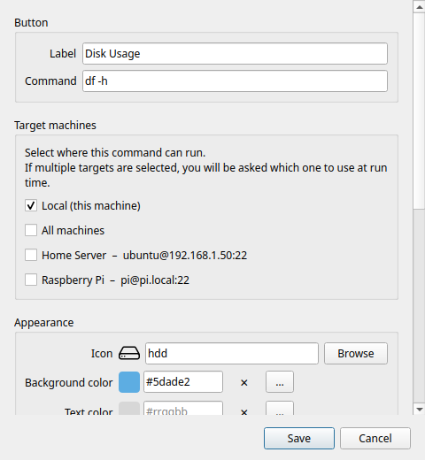

# Button Editor

!!! note "On Android"
    The phone's editor has the essentials: name, command, machines, category, command OS, icon,
    color, *Run as*, *Confirm before running*, execution mode, timeout and variables. Text color,
    *Hide label*, *Hide icon*, the tooltip and *Allow AI to run this button* exist only on the
    computer. A button on the phone always runs on your machines, never on the phone itself.

The Button Editor opens when you create a new button (**+** / `Ctrl+N`) or edit an existing one (right-click → **Edit**).



---

## Label

The text displayed on the button tile in the grid. Keep it short — long labels are truncated on small tiles.

---

## Command

The shell command to execute. This is a full bash command line. Examples:

```bash
df -h                             # disk usage summary
ping -c 4 8.8.8.8                 # connectivity check
sudo systemctl restart nginx      # restart a service
git -C ~/myproject pull           # update a repo
tar -czf ~/backup.tar.gz ~/docs   # create an archive
```

You can use shell features: pipes (`|`), redirects (`>`), command substitution (`$()`), and multi-statement chains (`&&`, `;`).

!!! warning
    Commands run as your current user (or via sudo if you include it in the command). There is no sandbox — the command has full access to your filesystem. Only add commands you trust.

---

## Target machines

Determines where the command runs. The list shows **Local** at the top, followed by all your configured SSH machines.

**Local** — runs on your computer using a standard subprocess. No SSH required.

**SSH machine** — enable one or more machines using their toggle switches. The command is executed on each enabled machine over SSH.

- If only **Local** is enabled: runs locally, no picker.
- If one machine is enabled (and Local is off): runs on that machine directly, no picker.
- If two or more targets are enabled: a [machine picker](ssh-machines.md#the-machine-picker) dialog appears at click time.

**All machines** — a toggle at the top of the machine list to select/deselect all machines at once (it picks every *OS-compatible* machine).

### Command OS

**Command OS** tells Commandeck which operating system this command is written for: **Cross-platform** (the default — runs anywhere), **Linux**, **macOS** or **Windows**. It does two things:

- In the machine list above, machines whose OS doesn't match are **greyed out** with a ⚠ marker, so you can't accidentally point a Linux command at a Windows machine (and vice-versa). A machine you'd already selected stays visible so you can remove it.
- On [import](../pro/backup.md), a Linux and a Windows version of the same button are kept side by side instead of clashing.

Each machine's OS is set in its [editor](ssh-machines.md); Linux and macOS are treated as compatible. Leave a button **Cross-platform** unless its command is OS-specific.

!!! tip "Pro feature"
    Adding SSH machines requires [Commandeck Pro](../pro.md). On the free tier, only **Local** is available.

---

## Appearance

### Icon

Choose an icon from the built-in icon picker. Only icons available and renderable on your system are shown.

Type in the search field to filter by name. The selected icon is previewed on the button preview at the top of the dialog.

To remove the icon entirely, enable **Hide icon** (see below).

### Background color

The fill color of the button tile. Click the color field to open the color picker:

- A 40-color GNOME palette for quick selection
- A hex input field (`#rrggbb`) for exact values

Leave blank for the default system tile color.

### Text color

The color of the button label. Independent from the background color. Same picker as above.

Leave blank to use the default label color (adapts automatically to light/dark mode).

### Hide label

When enabled, the button label is hidden — only the icon is shown. Useful for very small tiles or instantly recognisable icons.

### Hide icon

When enabled, the icon is hidden — only the label text is shown. Useful when no icon fits or when the label alone is clear enough.

---

## Organisation

### Category

Type a category name to assign this button to a group. Buttons sharing the same category name are grouped under the same entry in the [category filter](main-window.md#category-filter).

- Names are case-sensitive (`Server` and `server` are different categories)
- Leave blank to leave the button uncategorised
- To rename a category, edit all buttons in it and change the category name

Right-clicking a button in the grid also offers **Move to category** for quick reassignment.

---

## Behaviour

### Tooltip

Custom text shown when hovering the mouse over the button. If left blank, the tooltip defaults to the command string.

Use this to add a human-readable description when the command itself is not self-explanatory.

### Confirm before running

When enabled, clicking the button shows a confirmation dialog ("Run this command?") before executing. Useful for destructive commands like reboots, shutdowns, or deletions.

The global default for this toggle can be set in **Preferences → General → Confirm before running by default**.

### Execution mode

Controls what happens after the command runs.

| Mode | Behaviour |
|------|-----------|
| **Silent** | The command runs in the background. A toast shows success or failure. |
| **Show output** | A dialog opens with the full `stdout` / `stderr` after the command finishes. |
| **Open in terminal** | The command is launched in your system terminal emulator (full interactive session). |

!!! tip
    **Show output** opens automatically on failure regardless of the mode selected — you always see the error.

    Use **Open in terminal** for interactive programs: `htop`, `vim`, `python3`, `ssh` sessions, etc.

### Run as

Who runs the command — one list:

- **Connected account** *(default)* — the account the machine card connects with (or you, for a local button).
- **Administrator (root)** — runs it with administrator rights (`sudo`).
- **Other user…** — type a system username (e.g. `www-data`, `postgres`); runs it as that user (`sudo -u`).
- **Saved: *name*** *(Pro)* — a [saved "Run as"](execution-profiles.md): a user plus a working folder, reusable on many buttons.

There is no password here: `sudo` asks for the password of the **connected** account, which lives on the [machine card](ssh-machines.md#administrator-password) (or in [Preferences › This computer](preferences.md#this-computer) for this computer).

!!! warning "Warned before it fails"
    If the button needs administrator rights — a *Run as*, or a command containing `sudo` — and one of its machines cannot give them (no administrator password saved, a password refused at the last **Test**, an account not allowed to administer it), an orange box under **Run as** says so, and names the machine card to fix.

### Allow AI to run this button

!!! tip "Pro feature"
    Requires [Commandeck Pro](../pro.md) and the [MCP server](../pro/mcp.md).

Off by default. When this is on — **and** global AI execution is enabled in *Preferences → Desktop Integration* — an AI assistant may trigger this button via MCP. Pair it with **Confirm before running** so the AI must show you the exact command and wait for your approval. See [Security](security.md) and [Allowing AI to run buttons](../pro/mcp.md#allowing-ai-to-run-buttons).

---

## Saving

Click **Save** to confirm. The button appears immediately in the grid at the next available position.

To cancel without saving, press `Escape` or click outside the dialog.
