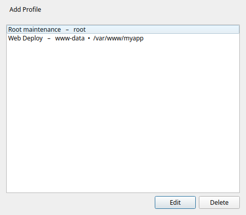
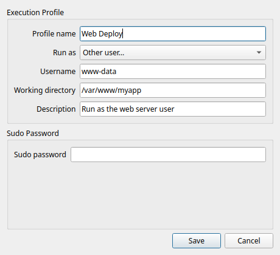

# «Ejecutar como» guardados

!!! tip "Función Pro"
    Los «Ejecutar como» guardados requieren [Commandeck Pro](../pro.md).

🔰 **En pocas palabras:** un «Ejecutar como» guardado (también llamado perfil) es un pequeño conjunto de «condiciones de ejecución» que guardas una vez y reutilizas en muchos botones: *quién* ejecuta el comando (otro usuario) y *dónde* se ejecuta (una carpeta). En lugar de escribir `sudo -u www-data` y `cd /var/www` en cada botón, lo defines una vez y lo eliges en el botón.

Un perfil **no guarda ninguna contraseña**. Para actuar como otro usuario, `sudo` pide la contraseña de la cuenta con la que estás *conectado*; por eso esa contraseña vive en la [ficha de la máquina](ssh-machines.md#contrasena-de-administrador) (o en [Preferencias › Este ordenador](preferences.md#este-ordenador) para este ordenador), y un mismo perfil sirve en todas las máquinas.

## Crear un perfil

Abre **Menú ☰ → «Ejecutar como» guardados → Añadir perfil** y rellena:

| Campo | Para qué sirve |
|-------|----------------|
| **Nombre** | Cómo aparece el perfil en la lista **Ejecutar como** del editor de botones (como «Guardado: …»). |
| **Ejecutar como usuario** | Ejecuta el comando con ese usuario en lugar del tuyo (usa `sudo -u <usuario>`). Déjalo vacío para ejecutarlo tú. |
| **Carpeta de trabajo** | La carpeta en la que arranca el comando (como si hicieras `cd` allí antes). |
| **Descripción** | Nota opcional para recordarte para qué es el perfil. |

## Usar un perfil en un botón

En el [editor de botones](button-editor.md), elige tu perfil en la lista **Ejecutar como**; aparece como **Guardado: *nombre***. El botón se ejecuta ahora con el usuario y la carpeta de ese perfil, y el campo del comando se queda limpio, solo con el comando de verdad.

!!! example "Antes y después"
    En lugar de un botón con `sudo -u www-data bash -c 'cd /var/www/app && git pull'`, crea:

    - un perfil **Despliegue web** → *Ejecutar como usuario* `www-data`, *Carpeta de trabajo* `/var/www/app`
    - un botón con el comando `git pull` y el perfil **Despliegue web**

    Más limpio, y el mismo perfil sirve para todos los botones de esa aplicación web.

!!! example "Apagar una máquina remota, el caso clásico"
    Usado por SSH (por ejemplo desde el móvil), el botón **Apagar** que viene por defecto falla con un mensaje sobre autenticación. El comando está bien: apagar una máquina necesita **permisos de administrador**, y una conexión remota no los recibe sola como cuando estás sentado delante del ordenador. (En tu propio escritorio, ese mismo botón funciona sin más.) Con **Reiniciar** pasa igual.

    La solución está en la **ficha de la máquina**, no en el botón:

    - si te conectas con **contraseña**, deja marcada **También es la contraseña de administrador (sudo)**; no hay nada más que hacer;
    - si te conectas con **clave SSH**, escribe tu contraseña en esa máquina en **Contraseña de admin**.

    Cuando un botón falla por falta de permisos de administrador, Commandeck lo vuelve a ejecutar una vez como administrador con esa contraseña, sin perfil y sin tocar el comando. Lo mismo vale para cualquier cosa que necesite permisos de administrador en esa máquina: reiniciar un servicio, instalar programas, montar un disco. **Probar** en la ficha de la máquina te dice si los permisos de administrador funcionan.

⚙️ **Para administradores de sistemas**

- *Ejecutar como usuario* envuelve el comando con `sudo -u <usuario>`. sudo autentica la cuenta **conectada**: Commandeck le responde con la contraseña de admin de la ficha de la máquina (o de Este ordenador), pasada por la entrada estándar (`sudo -S`), nunca en la línea de comandos, y el comando arranca con la entrada vacía.
- Un perfil se aplica **igual** en local que por SSH: el envoltorio `sudo -u` y la carpeta de trabajo se aplican en la máquina a la que apunte el botón.
- Los perfiles casan de forma natural con los [botones multimáquina](../use-cases/homelab.md): un perfil de despliegue, un botón, varios servidores.
- Un asistente de IA puede crear y asignar perfiles por ti mediante el [servidor MCP](../pro/mcp.md): descompone automáticamente una línea de comandos pegada en un perfil más un comando limpio.
