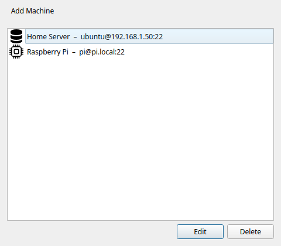
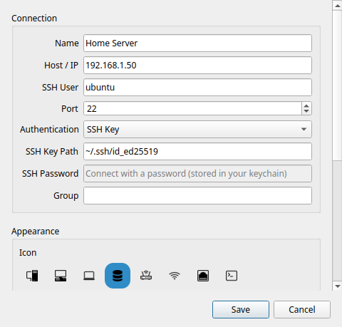
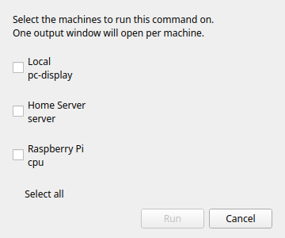

# Macchine SSH

!!! tip "Funzione Pro"
    Le macchine SSH richiedono [Commandeck Pro](../pro.md).

Commandeck si collega ai server remoti via SSH. Puoi identificarti con una **chiave SSH** (consigliata) oppure con una **password**. Se scegli la password, viene conservata nel portachiavi sicuro del tuo sistema operativo: mai in chiaro dentro un file di configurazione e mai dentro un backup.

---

## Gestire le macchine

Apri **Menu → Gestisci macchine** per vedere l'elenco completo. Da lì puoi aggiungere, modificare ed eliminare macchine.

!!! note
    La voce **Gestisci macchine** è bloccata nella versione gratuita.

---

## Rilevare le macchine in rete

Invece di scrivere un indirizzo IP a mano, premi **Rileva** nella finestra di gestione delle macchine. Commandeck perlustra la tua rete locale in cerca di dispositivi che accettano connessioni SSH (porta 22) ed elenca quelli che trova.

1. Commandeck compila da solo la **sottorete** della tua rete (per esempio `192.168.1.`). Se le tue macchine stanno in un altro intervallo — una VPN, o un router che usa `192.168.0.` — modifica quel campo e premi **Scansiona**.
2. Scegli un dispositivo fra i risultati e premi **Aggiungi questa macchina**. Il modulo si apre con indirizzo IP e nome già inseriti: ti resta da indicare l'utente SSH e la chiave, poi **Prova** e **Salva**.

Le macchine già aggiunte vengono nascoste dai risultati, così ti vengono proposti solo dispositivi nuovi.

!!! tip "Per far comparire i nomi dei dispositivi"
    Commandeck cerca di scoprire il nome di ogni dispositivo da solo, in quest'ordine: DNS inverso, poi **mDNS / Bonjour** (i nomi `.local` che annunciano i Mac, i Raspberry Pi con avahi e quasi tutti i NAS) e infine **NetBIOS** (Windows e Samba). I dispositivi che non si annunciano — di solito server senza schermo e container Docker — mostrano soltanto il proprio indirizzo IP.

    Perché anche quelli abbiano un nome, il tuo router o il tuo DNS deve rispondere alle richieste inverse della rete locale. Su **OPNsense / pfSense con Unbound**, attiva *Register DHCP leases* e *Register DHCP static mappings*. Se davanti a Unbound c'è un filtro DNS come **AdGuard Home** o Pi-hole, punta i suoi *server DNS inversi privati* sul risolutore Unbound perché le richieste `PTR` private ottengano risposta. Verifica da un terminale con `getent hosts <ip>`: appena restituisce il nome, rifai la scansione e Commandeck lo mostrerà a sua volta.

!!! note
    Il rilevamento trova i dispositivi che hanno l'SSH (porta 22) aperto. Un dispositivo protetto da un firewall può non comparire anche se ha l'SSH attivo.

---

## Finestra di aggiunta di una macchina

Premi **+** nella finestra delle macchine per aprire il modulo.

### Nome

Un nome visibile usato soltanto dentro Commandeck. Scegline uno descrittivo: lo vedrai negli editor dei pulsanti e nel selettore di macchina.

Esempi: `Server Plex`, `Pi-hole`, `Server di lavoro`, `NAS`

### Host / IP

L'indirizzo IP o il nome della macchina remota. Deve essere raggiungibile dal tuo computer attraverso la rete.

Esempi: `192.168.1.50`, `plex.local`, `mioserver.esempio.com`

### Utente SSH

Il nome utente con cui accedere alla macchina remota.

Esempi: `pi`, `ubuntu`, `admin`, `tuonome`

### Porta

La porta SSH. Quella predefinita è la **22**. Cambiala solo se il tuo server usa una porta diversa da quella abituale.

### Autenticazione

Scegli come Commandeck accede a questa macchina:

- **Chiave SSH** *(consigliata)*: usa un file di chiave privata (vedi [Percorso della chiave SSH](#ssh-key-path), più sotto). Una volta configurata non c'è nulla da scrivere né da conservare.
- **Password**: si collega con una password che Commandeck conserva nel portachiavi del tuo sistema (vedi [Password SSH](#ssh-password), più sotto).

Le chiavi SSH sono la scelta più sicura e più comoda: una volta configurate non digiti più nessuna password. L'autenticazione con password è lì per i server su cui non puoi installare una chiave.

### Percorso della chiave SSH

Il percorso del file di chiave privata usato per identificarsi.

Esempi: `~/.ssh/id_rsa`, `~/.ssh/id_ed25519`, `~/.ssh/chiave_mioserver`

Se il campo è vuoto, Commandeck ripiega sul tuo agente SSH o sulla chiave predefinita (`~/.ssh/id_rsa`).

!!! note
    Le chiavi con frase di accesso richiedono un `ssh-agent` in funzione con la chiave caricata. Se la chiave è bloccata, Commandeck mostra un errore chiaro: non ti chiederà la frase di accesso in modo interattivo.

### Password SSH

Si usa solo quando l'**autenticazione** è impostata su **Password**. Scrivi la password di accesso dell'utente remoto; Commandeck la salva e la usa a ogni connessione a questa macchina. Usa **Prova** per verificare che funzioni prima di salvare.

!!! info "Dove viene conservata la password"
    Le password salvate vivono nel portachiavi sicuro del tuo sistema operativo — **GNOME Keyring / KWallet** su Linux, **Portachiavi** su macOS, **Gestione credenziali** su Windows — cifrate a riposo. **Non** vengono mai scritte nei file di configurazione di Commandeck né incluse in un backup.

    Se non è disponibile nessun portachiavi di sistema (per esempio su una macchina Linux minimale o senza schermo), Commandeck ripiega su un file locale offuscato (`.secrets`, leggibile solo dal tuo account) e ti avverte che non è una cifratura forte. In quel caso è meglio una chiave SSH.

### Password di amministratore

Alcuni pulsanti hanno bisogno dei permessi di amministratore sulla macchina (riavviare un servizio, installare gli aggiornamenti, spegnere). `sudo` chiede allora la password dell'account con cui Commandeck **si collega**: per questo quella password appartiene a questa scheda della macchina, mai a un pulsante.

- **Accesso con password:** lascia spuntato **È anche la password di amministratore (sudo)** (è l'impostazione predefinita); la password di accesso risponde anche a `sudo`. Toglila solo se la password di amministratore di quell'account è diversa.
- **Accesso con chiave SSH:** scrivi la password dell'account in **Password admin**. È facoltativa: lasciala vuota se la macchina non la chiede mai (accesso come `root`, o `sudo` configurato senza password).

Viene conservata come la password SSH: nel portachiavi del sistema, mai in un file di configurazione né in un backup. Quando un pulsante fallisce per mancanza di permessi di amministratore, Commandeck lo riesegue una volta come amministratore con questa password. Se non ce n'è nessuna, il messaggio di errore lo dice e nomina questa scheda.

!!! tip "Due account sullo stesso computer"
    Una scheda della macchina è **un indirizzo + un account**. Per collegarti allo stesso computer con due utenti diversi, crea due schede (per esempio *Mini (fabien)* e *Mini (claude-ai)*). Per eseguire solo alcuni pulsanti come un altro utente, tieni una sola scheda e usa un [«Esegui come» salvato](execution-profiles.md): usa la password di amministratore di questa scheda.

### Icona

Un'icona che compare accanto al nome della macchina nel selettore e nell'elenco. Ce ne sono sei: computer fisso, portatile, server, router, punto di accesso Wi-Fi e un dispositivo generico.

---

## Preparare la chiave SSH

Se non hai ancora una coppia di chiavi SSH, Commandeck può generarla per te e copiare la chiave pubblica sul server:

1. Premi **Genera chiave SSH**: Commandeck crea una coppia di chiavi Ed25519 in `~/.ssh/`
2. Premi **Copia la chiave sul server**: scrivi la tua password una volta (non viene conservata). Internamente viene usato `ssh-copy-id`
3. Da lì in poi le connessioni usano la chiave in automatico, senza password

!!! note "Su Android"
    L'app Android non crea chiavi. Creala sul computer come sopra, poi, nella scheda della
    macchina sul telefono, incolla la chiave **privata** o tocca **Scegli file della chiave…**,
    oppure collegati con una password.

---

## Provare la connessione

Premi **Prova** nella finestra della macchina. Commandeck esegue `echo commandeck-ok` sull'host remoto. Un messaggio verde conferma che la connessione funziona. Se fallisce, viene mostrato l'errore completo di SSH.

Una seconda riga parla dei **permessi di amministratore**: sì (connesso come root), sì senza password, sì con la password salvata, serve una password e non ce n'è nessuna salvata, la password salvata è stata rifiutata, questo account non può amministrare la macchina, oppure `sudo` non è installato. L'editor dei pulsanti usa questa risposta per avvisarti *prima* che fallisca un pulsante che richiede i permessi di amministratore.

Fai la prova dopo aver aggiunto una macchina e ogni volta che cambi le credenziali.

---

## Assegnare le macchine a un pulsante

Nell'[editor dei pulsanti](button-editor.md), la sezione **Macchine di destinazione** mostra le tue macchine come interruttori. Attiva quelle che ti servono.

---

## Il selettore di macchina

Quando un pulsante ha due o più destinazioni attive, premendolo si apre il selettore di macchina.

Il selettore elenca ogni destinazione attiva. Scegline una e premi **Esegui**. Il comando viene eseguito solo sulla macchina scelta.

!!! tip
    Se vuoi eseguire su tutte le macchine insieme senza scegliere, puoi creare un pulsante per macchina, oppure usare la selezione multipla per eseguirli uno dopo l'altro.

---

## Modalità di output via SSH

Tutte e tre le modalità di esecuzione funzionano via SSH:

| Modalità | Comportamento |
|----------|---------------|
| **Silenzioso** | Il risultato appare come avviso a comparsa |
| **Mostra l'output** | Il testo normale e quello di errore della macchina remota vengono mostrati in una finestra quando il comando finisce |
| **Apri nel terminale** | Commandeck genera un comando `ssh -t` e lo apre nel tuo emulatore di terminale: sessione interattiva completa |

!!! note "Su Android"
    Su Android, **Apri nel terminale** apre una **vista dal vivo** in sola lettura dentro l'app:
    guardi il programma mentre gira, ma non puoi scriverci dentro. Un programma che si comanda con
    i tasti (`ncdu`, una shell) richiede un computer.
